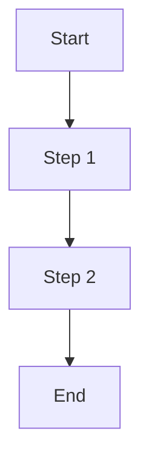

# Business Architecture Specification

> **Project:** 项目知识库 / MCP Knowledge Base Server
> **Version:** 1.0.0
> **Author:** Development Team
> **Created:** 2026-08-23 11:33:05

---

## 1. Project Overview

基于 Model Context Protocol (MCP) 的知识库服务器：为编码智能体提供知识管理（读/写/搜索/JSONPath 查询）、Spec 驱动开发（业务/技术/编码/模块规范生成）与代码反向同步（漂移检测），支持 stdio 传输与多工具集成（VS Code / Claude / Cursor / OpenCode）。

### 1.1 Background

Describe the business background and motivation for this project.

### 1.2 Scope

Define the scope of this project — what is included and what is explicitly excluded.

### 1.3 Goals & Objectives

- **Goal 1:** ...
- **Goal 2:** ...
- **Goal 3:** ...

---

## 2. Business Domain Model

### 2.1 Core Entities

| Entity | Description | Key Attributes |
|--------|-------------|----------------|
| EntityA | ... | ... |
| EntityB | ... | ... |

### 2.2 Domain Relationships

Describe how domain entities relate to each other.

### 2.3 Bounded Contexts

List the bounded contexts and their responsibilities.

---

## 3. Core Business Processes

### 3.1 Process Flow

### 3.2 Business Rules

| Rule ID | Description | Priority |
|---------|-------------|----------|
| BR-001 | ... | High/Medium/Low |

---

## 4. Use Cases

| UC ID | Name | Actor | Description |
|-------|------|-------|-------------|
| UC-001 | ... | ... | ... |

---

## 5. Stakeholders

| Role | Responsibility | Concerns |
|------|---------------|----------|
| Product Owner | ... | ... |
| Developer | ... | ... |

---

## 6. Key Performance Indicators

| KPI | Description | Target |
|-----|-------------|--------|
| KPI-001 | ... | ... |

---

## 7. Constraints & Assumptions

- **Constraint 1:** ...
- **Assumption 1:** ...
