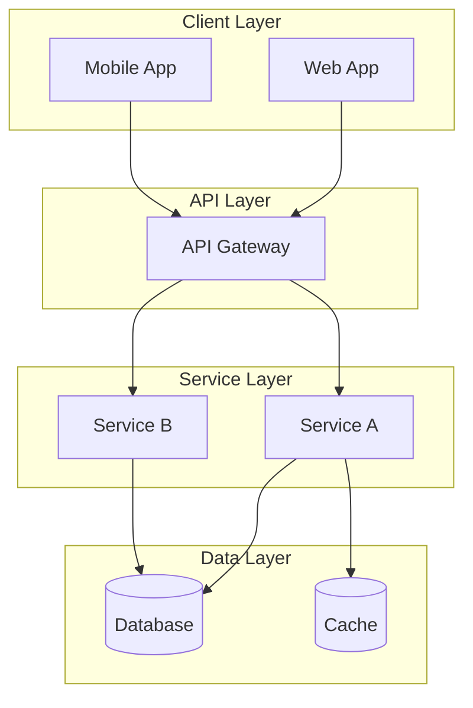
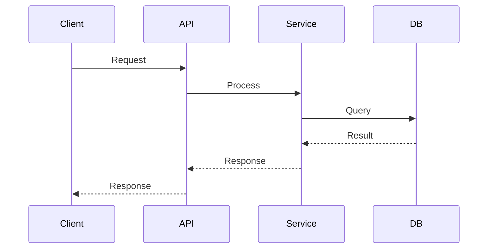

# Technical Architecture Specification

> **Project:** 项目知识库 / MCP Knowledge Base Server
> **Version:** 1.0.0
> **Author:** Development Team
> **Created:** 2026-08-23 11:33:05

---

## 1. Technology Stack

### 1.1 Languages
  - Python >= 3.10

### 1.2 Frameworks & Libraries
  - mcp (>=2.0.0)
  - click (>=8.1.0)
  - markdown (>=3.5.0)
  - jsonpath-ng (>=1.6.0)

### 1.3 Database
  - 无（基于文件系统，Markdown/JSON）

### 1.4 Message Queue
  - (to be decided)

### 1.5 Cache
  - (to be decided)

### 1.6 DevOps & Infrastructure
  - Docker
  - docker-compose
  - pip / pyproject.toml

### 1.7 Monitoring & Observability
  - logging（INFO/DEBUG 可配置）

---

## 2. System Architecture

### 2.1 Architecture Overview

Describe the system architecture (Monolithic / Microservices / Layered / Hexagonal, etc.).



### 2.2 Module Breakdown

| Module | Responsibility | Dependencies |
|--------|---------------|-------------|
| Module A | ... | ... |
| Module B | ... | ... |

---

## 3. Data Architecture

### 3.1 Data Model

Describe the core data entities and their relationships.

### 3.2 Data Flow



---

## 4. API Design

### 4.1 RESTful APIs

| Method | Endpoint | Description |
|--------|----------|-------------|
| GET | /api/v1/resource | List resources |
| POST | /api/v1/resource | Create resource |

### 4.2 Internal Interfaces

Describe inter-module communication interfaces.

---

## 5. Database Design

### 5.1 Schema

```sql
-- Core tables
CREATE TABLE example (
    id SERIAL PRIMARY KEY,
    name VARCHAR(255) NOT NULL,
    created_at TIMESTAMP DEFAULT NOW()
);
```

### 5.2 Indexing Strategy

| Table | Index | Type | Rationale |
|-------|-------|------|-----------|
| ... | ... | B-tree | ... |

---

## 6. Security Architecture

- **Authentication:** ...
- **Authorization:** ...
- **Data Encryption:** ...
- **Network Security:** ...

---

## 7. Deployment Architecture

### 7.1 Environment Strategy

| Environment | Purpose | Configuration |
|-------------|---------|--------------|
| dev | Development | ... |
| staging | Testing | ... |
| production | Live | ... |

### 7.2 CI/CD Pipeline

Describe the build, test, and deployment pipeline.

---

## 8. Scalability & Performance

- **Horizontal Scaling:** ...
- **Vertical Scaling:** ...
- **Caching Strategy:** ...
- **Rate Limiting:** ...

---

## 9. Disaster Recovery & Backup

- **Backup Strategy:** ...
- **Recovery Point Objective (RPO):** ...
- **Recovery Time Objective (RTO):** ...
