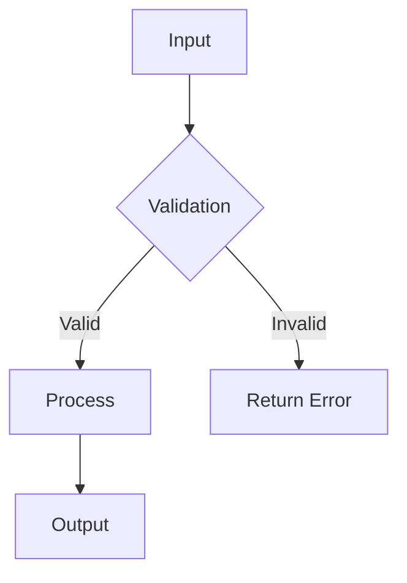

# Module Detailed Design Specification

> **Project:** 项目知识库 / MCP Knowledge Base Server
> **Module:** MCP Server Core (mcp_kb_server.py)
> **Version:** 1.0.0
> **Author:** Development Team
> **Created:** 2026-08-23 11:33:05

---

## 1. Module Overview

### 1.1 Purpose

MCP 服务器核心模块：知识库 CRUD、全文搜索、JSONPath 查询、Spec 生成与代码分析反向同步

### 1.2 Responsibilities

- Responsibility 1: ...
- Responsibility 2: ...
- Responsibility 3: ...

### 1.3 Scope

Define what this module does and explicitly what it does **not** do.

---

## 2. Interface Definition

### 2.1 Public API

| Method / Function | Signature | Description |
|-------------------|-----------|-------------|
| `func_a` | `(param1: str) -> Result` | ... |
| `func_b` | `(param2: int) -> None` | ... |

### 2.2 Events

| Event | Payload | Publisher | Subscriber |
|-------|---------|-----------|------------|
| `event_a` | `Ellipsis` | Module A | Module B |

### 2.3 Configuration

```python
# Configuration keys for this module
MODULE_CONFIG = {
    "setting_a": "default_value",
    "setting_b": 42,
}
```

---

## 3. Data Structures

### 3.1 Core Data Models

```python
@dataclass
class CoreEntity:
    """Description of this entity."""
    id: str
    name: str
    created_at: datetime
```

### 3.2 Internal State

Describe the internal state this module maintains (if any).

---

## 4. Core Logic / Algorithms

### 4.1 Flowchart



### 4.2 Pseudo-code / Key Algorithm

```
function handleRequest(input):
    1. validate input
    2. transform to internal model
    3. execute business rule
    4. persist result
    5. return response
```

### 4.3 Edge Cases

- Edge case 1: ...
- Edge case 2: ...
- Error scenario: ...

---

## 5. Dependencies

### 5.1 Internal Dependencies

| Module | Dependency Type | Description |
|--------|---------------|-------------|
| Module X | import / call | ... |

### 5.2 External Dependencies

| Library | Version | Purpose |
|---------|---------|---------|
| library-a | >=1.0 | ... |

---

## 6. Error Handling

| Error Condition | Error Type | Recovery Strategy |
|-----------------|-----------|-------------------|
| ... | `ValueError` | ... |

---

## 7. Testing Strategy

### 7.1 Unit Tests

| Test Case | Input | Expected Output |
|-----------|-------|-----------------|
| `test_case_a` | ... | ... |

### 7.2 Integration Points

Describe how to test this module's integration with other modules.

### 7.3 Mocking Strategy

Describe what external dependencies should be mocked during testing.

---

## 8. Performance Considerations

- **Expected load:** ...
- **Critical path:** ...
- **Optimisation opportunities:** ...

---

## 9. Open Questions

- [ ] Question 1: ...
- [ ] Question 2: ...
