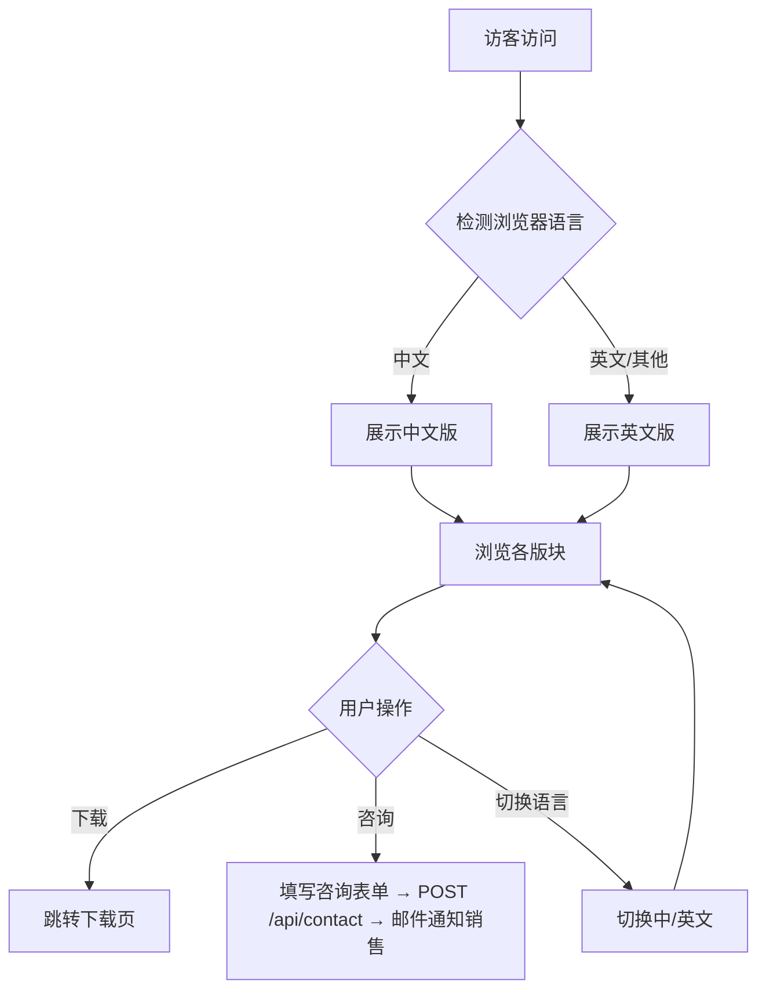

# 业务架构规范

> **项目：** renatte-site（瑞纳特官网）
> **版本：** 1.0.0
> **作者：** 南京瑞纳特智能技术有限公司
> **创建时间：** 2026-07-08

---

## 1. 项目概述

南京瑞纳特智能技术有限公司官方网站，面向产业园区管理者与企业用户，提供智慧园区解决方案展示、产品介绍、案例展示与 RenatteMD Markdown 编辑器下载功能。

### 1.1 业务背景

智慧园区行业正处于数字化转型浪潮中，瑞纳特作为园区数字化解决方案提供商，需要一个专业的官方网站实现：
- 品牌形象展示与市场推广
- 产品解决方案的场景化呈现
- 潜在客户的线索获取与转化
- RenatteMD 编辑器的分发渠道

### 1.2 范围

| 包含 | 不包含 |
|------|--------|
| 首页品牌与产品展示 | 在线交易/支付 |
| 智慧园区方案介绍（门禁/物业/能耗/停车/企业服务等） | 园区管理 SaaS 本身 |
| 典型案例展示 | 用户注册与社区 |
| RenatteMD 编辑器下载 | 第三方集成 |
| 管理后台（内容管理、分析统计） | |
| 中英文双语国际化 | |

### 1.3 目标

- 清晰传达瑞纳特的品牌定位与产品价值
- 支撑中国大陆及海外（英文）访客的浏览体验
- 提供便捷的软件下载与业务咨询入口
- 管理后台支持内容更新与访客数据分析

---

## 2. 业务领域模型

### 2.1 核心实体

| 实体 | 描述 | 关键属性 |
|------|------|----------|
| 访客 | 访问网站的用户 | 语言偏好、IP、会话 |
| 解决方案 | 智慧园区产品/功能 | 名称、描述、特性列表、分类 |
| 案例 | 客户成功案例 | 标题、描述、标签、所属行业 |
| 下载 | RenatteMD 编辑器分发包 | 版本、平台、文件链接 |
| 管理员 | 后台管理者 | 账号、角色、会话 |

### 2.2 领域关系

```
访客 --[浏览]--> 解决方案
访客 --[浏览]--> 案例
访客 --[下载]--> RenatteMD
访客 --[咨询]--> 业务联系（邮件）
管理员 --[管理]--> 内容（方案/案例/下载）
```

### 2.3 有界上下文

| 上下文 | 职责 |
|--------|------|
| 内容展示 | 首页渲染、产品/案例/关于等静态内容展示 |
| 国际化 | 中英文翻译、语言切换、偏好持久化 |
| 下载管理 | 分发包上传、版本管理、下载计数 |
| 管理后台 | 登录认证、内容编辑、分析看板 |

---

## 3. 核心业务流程

### 3.1 访客浏览流程



### 3.2 业务规则

| 规则 ID | 描述 | 优先级 |
|---------|------|--------|
| BR-001 | 首次访问根据浏览器语言自动选择展示语言 | 高 |
| BR-002 | 用户手动切换语言后，偏好存入 localStorage | 高 |
| BR-003 | 管理后台需要登录认证方能访问 | 高 |
| BR-004 | 下载链接指向服务器本地文件，不做 CDN | 低 |

---

## 4. 用例

| UC ID | 名称 | 执行者 | 描述 |
|-------|------|--------|------|
| UC-001 | 浏览产品方案 | 访客 | 查看智慧园区各模块产品介绍 |
| UC-002 | 查看案例 | 访客 | 浏览典型客户案例与行业标签 |
| UC-003 | 切换语言 | 访客 | 在中文/英文间切换，偏好持久化 |
| UC-004 | 下载软件 | 访客 | 选择对应平台下载 RenatteMD |
| UC-005 | 联系咨询 | 访客 | 填写表单（姓名/邮箱/电话/需求），通过 `POST /api/contact` 提交，服务端以邮件通知销售团队 |
| UC-006 | 后台管理 | 管理员 | 登录后管理内容与查看分析 |

---

## 5. 利益相关方

| 角色 | 职责 | 关注点 |
|------|------|--------|
| 访客/潜在客户 | 浏览网站获取信息 | 内容清晰、加载快、双语支持 |
| 管理员 | 维护网站内容 | 管理便捷、安全可靠 |
| 产品团队 | 展示产品价值 | 展示效果、案例呈现 |
| 运维 | 确保服务可用 | 部署便捷、监控完善 |

---

## 6. 关键指标

| KPI | 描述 | 目标 |
|-----|------|------|
| 页面加载时间 | 首页 FCP | < 2s |
| 语言切换成功率 | 切换后内容正确渲染 | 100% |
| 可用性 | 服务在线时间 | 99.9% |

---

## 7. 约束与假设

- **约束：** 项目为静态内容为主的展示型网站，不涉及复杂业务逻辑
- **约束：** 部署在腾讯云单节点，无集群/容器化
- **约束：** 国际化仅支持中英文两种语言
- **假设：** 大部分访客来自中国境内，中文为主要浏览语言
- **假设：** 管理后台仅管理员使用，无需多租户
