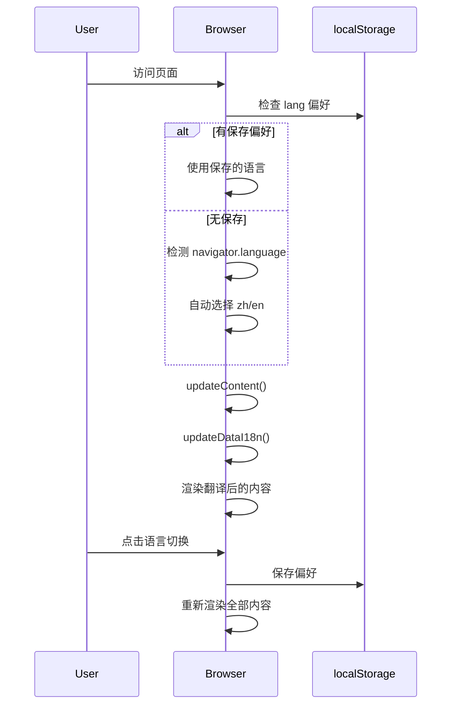
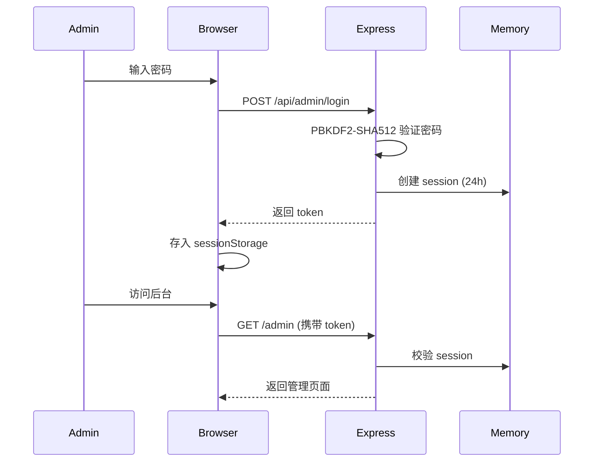

# 技术架构规范

> **项目：** renatte-site（瑞纳特官网）
> **版本：** 1.0.0
> **作者：** 南京瑞纳特智能技术有限公司
> **创建时间：** 2026-07-08

---

## 1. 技术栈

### 1.1 语言
- **HTML5** — 语义化标记，SEO 友好
- **CSS3** — Tailwind CSS 工具类 + 自定义样式
- **JavaScript (ES6+)** — 前端交互逻辑
- **Node.js (v20+)** — 服务端运行环境

### 1.2 框架与库

| 层级 | 技术 | 用途 |
|------|------|------|
| 前端样式 | Tailwind CSS (CDN) | 原子化 CSS，快速构建 UI |
| 前端交互 | Vanilla JS | 无框架，直接 DOM 操作 |
| 服务端 | Express.js | HTTP 路由、静态文件、API |
| 数据库 | better-sqlite3 + SQLite | 结构化数据持久化（替代 JSON 文件） |
| 进程管理 | PM2 | 生产环境守护进程 |

### 1.3 基础设施

| 项目 | 详情 |
|------|------|
| 服务器 | 腾讯云轻量应用服务器 |
| 系统 | Ubuntu 24.04 LTS |
| 反向代理 | Nginx（纯代理，不直接返回静态文件） |
| SSL | Let's Encrypt (Certbot) |
| 部署 | SCP 上传 + PM2 手动重启 |

---

## 2. 系统架构

### 2.1 架构概览

```
                          ┌─────────────────────────────┐
                          │        浏览器 (Client)        │
                          │  index.html · i18n.js · CSS  │
                          └─────────────┬───────────────┘
                                        │ HTTP/HTTPS
                                        ▼
                          ┌─────────────────────────────┐
                          │   Nginx (:80 / :443)          │
                          │   SSL 终止 · 安全头 · 速率限制 │
                          │   proxy_pass → :3000         │
                          └─────────────┬───────────────┘
                                        │
                                        ▼
                          ┌─────────────────────────────┐
                          │   Node.js Express (:3000)     │
                          │  ┌─────────────────────────┐ │
                          │  │ 静态文件 (express.static) │ │
                          │  │ · HTML/CSS/JS           │ │
                          │  ├─────────────────────────┤ │
                          │  │ API 路由                 │ │
                          │  │ · 管理后台登录/验证       │ │
                          │  │ · 文件上传/管理           │ │
                          │  │ · 分析追踪               │ │
                          │  ├─────────────────────────┤ │
                          │  │ 中间件栈                  │ │
                          │  │ · 自定义安全头(CSP/XFO)     │ │
                          │  │ · 自定义 CORS · CSRF        │ │
                          │  │ · cookie-parser · CSP       │ │
                          │  └─────────────────────────┘ │
                          └─────────────────────────────┘
```

### 2.2 模块划分

| 模块 | 职责 | 依赖 |
|------|------|------|
| `index.html` | 首页骨架、SEO meta、各版块 HTML 结构 | Tailwind CDN |
| `css/style.css` | 全局样式、主题变量 | — |
| `css/i18n.css` | 语言切换按钮样式 | — |
| `js/i18n.js` | 国际化引擎：语言检测、切换、DOM 更新（逻辑层） | — |
| `locales/zh.js` / `locales/en.js` | 翻译数据（与逻辑分离，经 `<script>` 加载为 `LOCALE_zh`/`LOCALE_en`） | — |
| `admin/index.html` | 管理后台数据概览 + 数据详情弹窗 | — |
| `admin/login.html` | 管理后台登录页（验证码 + 密码 + OTP） | — |
| `server/server.js` | Express 应用入口、路由、中间件、会话/CSRF/验证码/OTP | express, better-sqlite3, multer, nodemailer, body-parser, cookie-parser, dotenv |
| `server/database.js` | SQLite 初始化、迁移、CRUD、统计查询（失败降级 JSON） | better-sqlite3 |
| `scripts/check-i18n.js` | 翻译 key 完整性校验（zh/en 对齐） | — |
| `scripts/tools/*.py` | 部署/SSL/数据修复等运维脚本 | Python |

### 2.3 国际化架构

当前实现（优化后，v2.0）：

```
locales/zh.js + locales/en.js   ← 翻译数据（~480 key，经 <script> 加载）
js/i18n.js (214行)
├── init()              ← 语言检测 + 加载 LOCALE_zh/LOCALE_en + 渲染
├── setLanguage()       ← 切换语言
├── updateContent()     ← 标题/meta/语言切换按钮等
├── updateDataI18n()    ← data-i18n 属性驱动 DOM 更新（主力机制）
├── updateDownloadLinks() ← 动态版本号/下载链接
└── resolvePath()       ← 点分隔 key 路径解析
scripts/check-i18n.js   ← 翻译 key 完整性校验（zh/en key 对齐）
```

**设计原则：** 新增内容只需加 `data-i18n` 属性 + 两侧翻译 key，无需改动 JS 逻辑；`check-i18n.js` 自动校验遗漏。

---

## 3. 数据架构

### 3.1 数据流

#### 国际化流程



#### 管理后台认证流程



### 3.2 存储

| 数据 | 存储位置 | 格式 | 持久化 |
|------|----------|------|--------|
| 翻译数据 | `js/i18n.js` (translations 对象) | JS Object | 代码内嵌 |
| 语言偏好 | `localStorage('lang')` | String | ✅ 浏览器 |
| 管理员会话 | 服务端内存 Map | Map<String, Session> | ❌ 重启丢失 |
| CSRF token | 服务端内存 Map | Map<String, Token> | ❌ 重启丢失 |
| 分析数据 | `data/analytics.db` (主) / `data/analytics/` (降级) | SQLite / JSON | ✅ 文件系统 |
| 管理员配置 | `data/analytics.db` (主) / `data/admin-config.json` (降级) | SQLite / JSON | ✅ 文件系统 |
| 审计日志 | `data/analytics.db` (主) / `data/audit-log.json` (降级) | SQLite / JSON | ✅ 文件系统 |

---

## 4. API 设计

| 方法 | 端点 | 描述 | 鉴权 |
|------|------|------|------|
| GET | `/api/captcha` | SVG 验证码 | 无 |
| GET | `/api/csrf-token` | 获取 CSRF token（管理后台） | 无 |
| POST | `/api/contact` | 业务咨询表单提交（邮件通知） | 验证码 |
| GET | `/api/health` | 健康检查 | 无 |
| POST | `/api/analytics/pageview` | 访问埋点 | 无 |
| POST | `/api/analytics/download` | 下载埋点 | 无 |
| POST | `/api/admin/send-otp` | 发送邮箱验证码 | 密码初步验证 + 验证码 |
| POST | `/api/admin/login` | 管理员登录 | 密码 + OTP |
| GET | `/api/admin/session` | 校验当前会话 | Session token |
| DELETE | `/api/admin/session` | 登出（删除会话） | Session token |
| GET | `/api/admin/stats` | 获取聚合统计数据 | Session token |
| GET | `/api/admin/stats/pageviews` | 分页查询访问明细 | Session token |
| GET | `/api/admin/stats/downloads` | 分页查询下载明细 | Session token |
| GET | `/api/admin/audit-log` | 查询审计日志 | Session token |
| GET | `/api/admin/cleanup` | 预览待清理数据 | Session token |
| POST | `/api/admin/cleanup` | 清理统计数据 | Session token + CSRF |
| POST | `/api/admin/password` | 修改管理员密码 | Session token + CSRF |
| POST | `/api/admin/upload` | 上传下载文件 | Session token + CSRF |
| DELETE | `/api/admin/downloads/:filename` | 删除上传文件 | Session token + CSRF |
| GET | `/api/downloads` | 下载文件列表 | 无 |

---

## 5. 安全架构

| 维度 | 方案 |
|------|------|
| 密码存储 | PBKDF2-SHA512，迭代次数自定义 |
| 会话 | 内存 Map，24h 过期，x-admin-token header |
| CSRF | Double-Submit Cookie 模式，4h 过期 |
| 验证码 | SVG 图形验证码，5min 过期 |
| OTP | 6 位邮箱验证码，5min 过期 |
| 速率限制 | Nginx 限制登录/OTP/验证码接口 |
| SSL | TLSv1.2 + TLSv1.3，Let's Encrypt |
| 安全头 | HSTS, XFO, CSP, XSS-Protection 等 |

---

## 6. 部署架构

### 6.1 环境

| 环境 | 用途 | 配置 |
|------|------|------|
| 生产 | 线上服务 | 腾讯云 Ubuntu 24.04, PM2 |

### 6.2 部署流程

```bash
# 1. 上传更新文件
scp <本地文件> ubuntu@49.233.160.241:/tmp/

# 2. 替换到工作目录
sudo cp /tmp/<文件> /home/ubuntu/renatte-website/<路径>

# 3. 重启 Node.js
pm2 restart server

# 4. 重载 Nginx（仅配置变更时）
sudo nginx -t && sudo systemctl reload nginx
```
