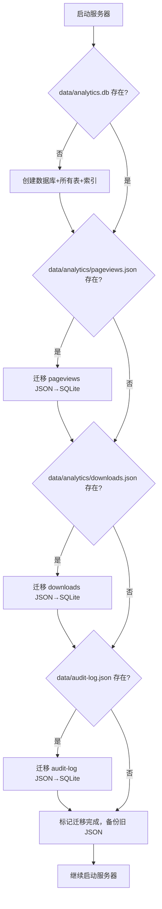

# 模块详细设计 — analytics-db：SQLite 数据库与数据详情查看

> **项目：** renatte-site（瑞纳特官网）
> **模块：** analytics-db — SQLite 数据库存储 + 数据详情查看
> **版本：** 2.1.0
> **作者：** 南京瑞纳特智能技术有限公司
> **创建时间：** 2026-07-11

---

## 1. 模块概述

### 1.1 目的

将当前基于 JSON 文件的内存存储方案替换为 SQLite 关系型数据库，提升数据读写性能与查询灵活性；同时为管理后台数据概览页面的每个统计卡片添加"点击查看详细数据列表"功能，方便管理员追溯明细。

### 1.2 职责

| # | 职责 | 当前状态 | 目标状态 |
|---|------|----------|----------|
| 1 | Pageview 数据持久化 | JSON 文件 | SQLite 表 |
| 2 | Download 数据持久化 | JSON 文件 | SQLite 表 |
| 3 | Audit Log 持久化 | JSON 文件 | SQLite 表 |
| 4 | Admin 配置持久化 | JSON 文件 | SQLite 表 |
| 5 | 统计数据聚合查询 | 全量加载后在内存过滤 | SQL 聚合查询 |
| 6 | 数据详情查询（按时间段筛选+分页） | ❌ 不支持 | ✅ 新增 API |
| 7 | 旧数据迁移 | ❌ 不支持 | ✅ 自动迁移 |
| 8 | 数据概览卡片点击查看明细 | ❌ | ✅ 弹窗+分页列表 |

### 1.3 范围

**包含：**
- SQLite 数据库初始化（表创建、索引）
- 从 JSON 文件到 SQLite 的自动数据迁移（幂等）
- Pageview / Download / AuditLog / AdminConfig 四张表
- 所有数据读写接口改用 SQLite
- 新增数据详情列表 API（分页、按时间筛选）
- 前端的弹窗数据列表组件

**不包含：**
- 用户/权限管理
- 实时数据推送（WebSocket）
- 数据可视化图表的增强

---

## 2. 接口定义

### 2.1 新增 API

| 方法 | 路径 | 参数 | 说明 |
|------|------|------|------|
| GET | `/api/admin/stats/pageviews` | `period=today\|week\|month\|all`, `page`, `pageSize` | 分页查询访问明细 |
| GET | `/api/admin/stats/downloads` | `period=today\|week\|month\|all`, `page`, `pageSize` | 分页查询下载明细 |

### 2.2 改造的 API（内部行为变更，接口不变）

| 方法 | 路径 | 变更内容 |
|------|------|----------|
| POST | `/api/analytics/pageview` | 写入 SQLite pageviews 表代替 append JSON |
| POST | `/api/analytics/download` | 写入 SQLite downloads 表代替 append JSON |
| GET | `/api/admin/stats` | 改用 SQL 聚合查询 |
| GET | `/api/admin/audit-log` | 改用 SQL 查询 |
| POST | `/api/admin/login` | 读取 admin_config 表 |
| POST | `/api/admin/password` | 写入 admin_config 表 |

### 2.3 前端新增/改造

| UI 元素 | 所在位置 | 说明 |
|---------|----------|------|
| 数据概览卡片 8 个 | `admin/index.html` | 每个卡片增加 `cursor:pointer` + 点击事件 |
| 数据详情弹窗 | `admin/index.html` | 模态弹窗含表格、分页、时间段筛选 |

---

## 3. 数据模型

### 3.1 核心数据模型

#### pageviews 表

```sql
CREATE TABLE IF NOT EXISTS pageviews (
  id         INTEGER PRIMARY KEY AUTOINCREMENT,
  path       TEXT NOT NULL DEFAULT '/',
  referrer   TEXT NOT NULL DEFAULT '',
  user_agent TEXT NOT NULL DEFAULT '',
  timestamp  INTEGER NOT NULL
);
CREATE INDEX IF NOT EXISTS idx_pv_timestamp ON pageviews(timestamp);
```

#### downloads 表

```sql
CREATE TABLE IF NOT EXISTS downloads (
  id         INTEGER PRIMARY KEY AUTOINCREMENT,
  filename   TEXT NOT NULL DEFAULT 'unknown',
  version    TEXT NOT NULL DEFAULT 'unknown',
  platform   TEXT NOT NULL DEFAULT 'unknown',
  timestamp  INTEGER NOT NULL
);
CREATE INDEX IF NOT EXISTS idx_dl_timestamp ON downloads(timestamp);
```

#### audit_logs 表

```sql
CREATE TABLE IF NOT EXISTS audit_logs (
  id         INTEGER PRIMARY KEY AUTOINCREMENT,
  event      TEXT NOT NULL,
  ip         TEXT NOT NULL DEFAULT '',
  details    TEXT NOT NULL DEFAULT '{}',
  timestamp  TEXT NOT NULL
);
CREATE INDEX IF NOT EXISTS idx_audit_timestamp ON audit_logs(timestamp);
```

#### admin_config 表

```sql
CREATE TABLE IF NOT EXISTS admin_config (
  key   TEXT PRIMARY KEY,
  value TEXT NOT NULL
);
```

### 3.2 内部状态

数据库连接由 `server/database.js` 模块管理，导出 `db` 单例为 `better-sqlite3` 实例。模块中还封装了辅助函数：

- `initDatabase()` — 数据库初始化、建表、旧 JSON 数据迁移（内部调用 `migrateFromJSON()`）
- `insertPageview(path, referrer, userAgent)` — 插入 pageview
- `insertDownload(filename, version, platform)` — 插入 download
- `insertAuditLog(event, ip, details)` — 插入审计日志
- `queryPageviews(period, page, pageSize)` — 分页查询 pageview
- `queryDownloads(period, page, pageSize)` — 分页查询 download
- `queryAuditLogs(limit)` — 审计日志查询（最近 N 条，倒序）
- `getAdminConfig(key)` / `setAdminConfig(key, value)` — 配置读写
- `getAllAdminConfig()` — 读取全部配置
- `getStats()` — 聚合统计查询（pageviews/downloads 的 today/week/month/total + 30 天每日分组 + 按文件名/版本/平台分组）

---

## 4. 核心逻辑

### 4.1 数据库初始化流程



### 4.2 统计数据聚合 SQL

```sql
-- pageviews 聚合
SELECT
  COUNT(*) AS total,
  SUM(CASE WHEN timestamp >= ? THEN 1 ELSE 0 END) AS today,
  SUM(CASE WHEN timestamp >= ? THEN 1 ELSE 0 END) AS week,
  SUM(CASE WHEN timestamp >= ? THEN 1 ELSE 0 END) AS month
FROM pageviews;

-- daily 分组
SELECT DATE(timestamp / 1000, 'unixepoch') AS date, COUNT(*) AS count
FROM pageviews WHERE timestamp >= ?
GROUP BY date ORDER BY date;
```

### 4.3 数据详情分页查询

```sql
SELECT * FROM pageviews
WHERE timestamp >= ? AND timestamp < ?
ORDER BY timestamp DESC
LIMIT ? OFFSET ?;
```

### 4.4 前端弹窗交互

1. 用户点击任意统计卡片
2. 读取卡片 `data-type`（pageviews|downloads）和 `data-period`（today|week|month|all）
3. 调用对应 API 获取第 1 页数据
4. 弹窗显示表格 + 分页控件 + 时间段标签
5. 翻页时只请求新数据（不关闭弹窗）

### 4.5 边界情况

- **空 JSON 文件**：迁移时跳过，不报错
- **数据库已存在但表不完整**：`CREATE TABLE IF NOT EXISTS` 保证幂等
- **大 JSON 文件**：迁移时使用 `db.transaction()` 包裹全部插入操作，单次事务提交
- **并发写入**：better-sqlite3 同步 API，天然无竞态，无需额外加锁
- **时间戳为 0 或非法值**：通过 `getPeriodRange()` 确保查询范围下限合法；非法数据自然被排除在统计范围外
- **period 参数非法**：API 返回 400 并提示可选值 `today`, `week`, `month`, `all`

---

## 5. 依赖关系

### 5.1 内部依赖

| 模块 | 依赖类型 | 说明 |
|------|---------|------|
| `server/server.js` | import | 引入 `database.js` 导出的函数 |

### 5.2 外部依赖

| 库 | 版本 | 用途 |
|----|------|------|
| `better-sqlite3` | ^11.x | SQLite 数据库操作（同步 API，无需 async/await） |

---

## 6. 错误处理

| 错误条件 | 错误类型 | 恢复策略 |
|---------|----------|---------|
| 数据库文件无法创建 | throw | 打印错误日志，继续使用 JSON 文件兜底 |
| JSON 文件迁移时读取失败 | log | 跳过该文件，不影响服务启动 |
| SQL 查询失败（库损坏） | log | 返回空结果，不抛 500 |
| 数据库写满/磁盘满 | log | 返回错误响应给客户端 |
| API 参数 page/period 非法 | 400 | 返回错误说明 |

---

## 7. 测试策略

### 7.1 手动测试场景

| 测试场景 | 操作 | 预期结果 |
|---------|------|----------|
| 首次启动（无数据库） | `node server/server.js` | 自动创建数据库和表，迁移旧 JSON 数据 |
| 已有数据库启动 | `node server/server.js` | 跳过迁移，正常使用 |
| 访问首页 | 访问 `http://localhost:3000` | POST `/api/analytics/pageview` 写入 SQLite |
| 下载文件 | 点击下载按钮 | POST `/api/analytics/download` 写入 SQLite |
| 数据概览 | 访问管理后台 | 统计数据正常展示 |
| 点击访问量卡片 | 点击"今日访问量"卡片 | 弹窗显示今日访问明细列表，支持翻页 |
| 点击下载量卡片 | 点击"累计下载量"卡片 | 弹窗显示全部下载明细列表 |

### 7.2 回退方案

如 SQLite 初始化失败，服务器应降级继续运行（保留 JSON 文件读写能力）。通过在 `database.js` 中捕获初始化异常，导出 `isReady` 标志，供 `server.js` 条件判断。

---

## 8. 性能考量

- **数据量预期**：Pageviews 日均 < 1000 条，年累计 < 40 万条
- **瓶颈**：之前 JSON 方案每次加载全量 → O(n) 扫描；SQLite 改用索引 + 聚合 → O(log n)
- **索引**：`timestamp` 字段加索引覆盖所有时间范围查询
- **写入频率低**：每次请求写入一条，better-sqlite3 同步写入 < 1ms
- **分页**：设置默认 20 条/页，最大 100 条/页，防止前端渲染过慢
- **WAL 模式**：`journal_mode = WAL` + `synchronous = NORMAL` 已启用，提升并发读性能

---

## 9. 数据清理机制

### 9.1 自动清理策略

| 表 | 默认保留天数 | 说明 |
|----|-------------|------|
| `pageviews` | 90 天 | 访问记录，3 个月内的明细有参考价值 |
| `downloads` | 365 天 | 下载记录，保留全年用于版本分析 |
| `audit_logs` | 90 天 | 审计日志，合规保留 3 个月 |

### 9.2 清理触发方式

| 方式 | 时机 | 说明 |
|------|------|------|
| 启动清理 | 服务器启动时 | `initDatabase()` 末尾调用 `autoCleanup()` |
| 定时清理 | 每 24 小时 | `setInterval(autoCleanup, 24h)` |
| 手动触发 | 管理后台"系统设置→数据存储与清理" | `POST /api/admin/cleanup` |

### 9.3 清理逻辑

1. 从 `admin_config` 表读取 `retention_<table>_days`（若无则用默认值）
2. 计算截止时间戳 `now - days * 24h`
3. `DELETE FROM <table> WHERE timestamp < cutoff`
4. 记录删除行数到日志
5. 不自动执行 `VACUUM`（SQLite 的 `VACUUM` 会重建整库，在删除后可节省空间但耗时较久；空闲空间会被后续写入自动复用，无需急于回收）

### 9.4 管理后台 UI

系统设置页新增"数据存储与清理"面板，展示：
- 各表当前行数 + 数据库文件大小
- 每张表的保留天数输入框（可自定义）
- "立即清理"按钮，点击后更新配置 + 执行清理 + 刷新状态

### 9.5 扩展性

保留天数通过 `admin_config` 表的 `retention_<table>_days` 键控制，可直接在管理后台修改，也可通过数据库直接更新：

```sql
INSERT OR REPLACE INTO admin_config (key, value) VALUES ('retention_pageviews_days', '180');
```

---

## 10. 待办/开放问题

- [ ] 是否需要自动 VACUUM 策略（当前采用写入复用空闲空间的方式）
- [ ] 是否需要对 `pageviews.path` 字段加索引（如果后期有按路径统计需求）
