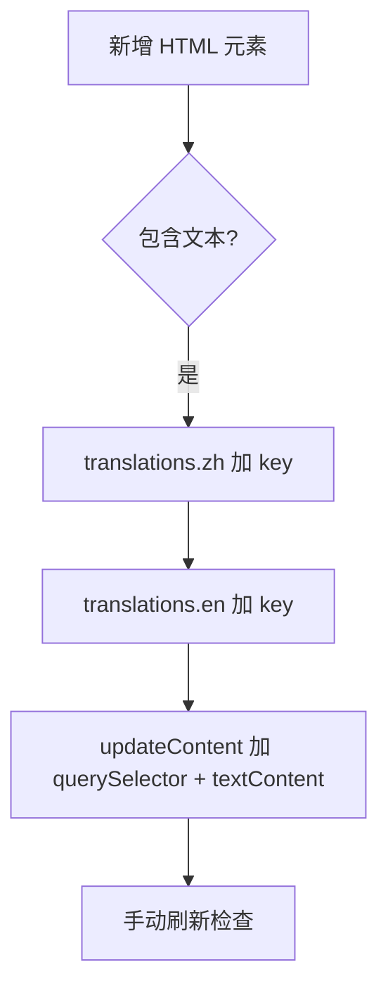
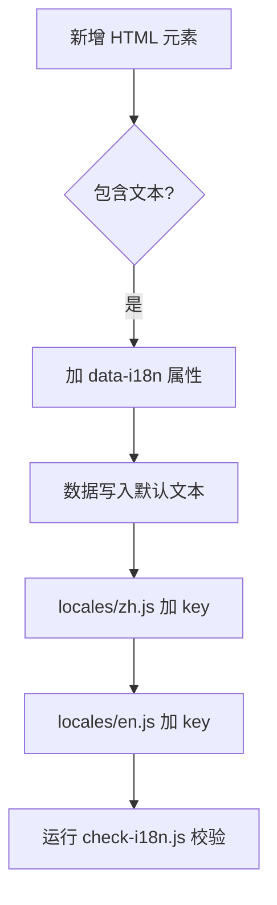

# 模块详细设计 — i18n 国际化模块

> **项目：** renatte-site（瑞纳特官网）
> **模块：** i18n - 国际化模块
> **版本：** 2.0.0（✅ 已落地，2026-07 重构完成）
> **当前版本：** 2.0.0（`js/i18n.js` 逻辑层 214 行 + `locales/zh.js`/`en.js` 数据层）
> **作者：** 南京瑞纳特智能技术有限公司
> **创建时间：** 2026-07-08
> **更新时间：** 2026-08-01

---

## 1. 模块概述

### 1.1 目的

提供中英文双语支持，使网站内容能根据用户语言偏好自动渲染为中文或英文。核心设计原则：**消除"改 HTML 必须改 JS"的耦合**，让国际化管理更简洁可靠。

### 1.2 职责

| # | 职责 | 当前状态 |
|---|------|----------|
| 1 | 翻译数据存储与管理 | ✅ 分离至 locales/zh.js + en.js |
| 2 | 浏览器语言自动检测 | ✅ 实现 |
| 3 | 语言偏好持久化（localStorage） | ✅ |
| 4 | 语言切换时全页面内容更新 | ✅ data-i18n 统一驱动 |
| 5 | 翻译 key 完整性校验 | ✅ scripts/check-i18n.js |
| 6 | 新增内容时自动检测遗漏 | ✅ check-i18n.js 自动校验 |

### 1.3 范围

| 包含 | 不包含 |
|------|--------|
| 中英文翻译管理 | 多语言扩展（>2种） |
| 语言自动检测 + 手动切换 | 服务端渲染 (SSR) |
| data-i18n 属性驱动的 DOM 更新 | 复数/性别等 ICU 消息格式 |
| 翻译 key 自动化校验脚本 | 第三方翻译平台集成 |
| 翻译数据与逻辑代码分离 | 动态加载按需翻译 |

---

## 2. 接口定义

### 2.1 全局 API

当前 `i18n` 对象对外暴露的接口（优化后保持一致）：

| 方法 | 签名 | 描述 |
|------|------|------|
| `init()` | `() => void` | 初始化：检测语言偏好 → 渲染内容 |
| `setLanguage(lang)` | `(lang: string) => void` | 切换语言：保存 → 重新渲染 |
| `getCurrentLang()` | `() => string` | 获取当前语言 'zh' \| 'en' |
| `t(path)` | `(path: string) => string` | 按路径获取翻译文本（**新增**） |
| `updateDataI18n()` | `() => void` | 扫描 `[data-i18n]` 更新所有元素 |

### 2.2 HTML 接口

```html
<!-- 所有需要翻译的元素使用 data-i18n 属性 -->
<h1 data-i18n="hero.title">构建新一代智慧园区数字化平台</h1>
<p data-i18n="hero.desc">描述文本...</p>
<span class="stat-label" data-i18n="stats.aiModels">AI智能体模型</span>
```

### 2.3 配置

| 配置项 | 类型 | 默认值 | 描述 |
|--------|------|--------|------|
| `SUPPORTED_LANGS` | `string[]` | `['zh', 'en']` | 支持的语言列表 |
| `STORAGE_KEY` | `string` | `'lang'` | localStorage 存储 key |
| `LOCALE_zh` | `object` | 由 `locales/zh.js` 注入 | 中文翻译全局变量 |
| `LOCALE_en` | `object` | 由 `locales/en.js` 注入 | 英文翻译全局变量 |

> **加载方式：** `index.html` 中按顺序引入 `<script src="locales/zh.js">`、`<script src="locales/en.js">`，两个文件将翻译对象赋给全局变量 `LOCALE_zh` / `LOCALE_en`；`i18n.init()` 再从全局变量读取。

---

## 3. 数据结构

### 3.1 翻译数据格式（优化后）

翻译数据从 `js/i18n.js` 中分离为独立 JS 文件（`locales/zh.js` / `locales/en.js`，各约 315 行）：

```javascript
// locales/zh.js —— 导出全局变量 LOCALE_zh
const LOCALE_zh = {
  "meta": {
    "title": "南京瑞纳特智能技术有限公司 - 智慧园区软件平台",
    "description": "..."
  },
  "navbar": {
    "products": "核心服务",
    "features": "核心优势",
    "cases": "案例展示",
    "about": "关于我们",
    "download": "软件下载",
    "contact": "联系我们",
    "consult": "立即咨询"
  },
  "hero": {
    "tag": "AI时代的智慧园区服务商",
    "title": "构建新一代",
    "subtitle": "智慧园区",
    "titleSuffix": "数字化平台",
    "desc": "南京瑞纳特智能技术有限公司...",
    "cta1": "预约演示",
    "cta2": "了解产品",
    "dashboard": {
      "title": "智慧园区管理平台 · 运营看板",
      "visitors": "今日访客",
      "visitorsChange": "↑ 12% 较昨日",
      "enterprises": "入驻企业",
      "enterprisesChange": "↑ 3 本月新增",
      "energyTrend": "园区能耗趋势（本周）",
      "weekdays": ["一", "二", "三", "四", "五", "六", "日"],
      "accessNormal": "门禁系统 正常",
      "pending": "条待处理",
      "securityIndex": "安全指数",
      "repairDone": "报修已处理",
      "responseTime": "平均响应 < 2h"
    }
  },
  "stats": { ... },
  "products": { ... },
  "features": { ... },
  "cases": { ... },
  "about": { ... },
  "contact": { ... },
  "footer": { ... },
  "download": { ... }
}
```

### 3.2 核心状态

```javascript
// i18n 模块内部状态
const state = {
  currentLang: 'zh',           // 当前语言
  translations: null,          // 当前语言的翻译对象
  fallbackLang: 'zh',          // 回退语言
};
```

### 3.3 key 路径解析规则

```
"hero.title"          → translations['zh']['hero']['title']
"hero.dashboard.title" → translations['zh']['hero']['dashboard']['title']
"stats.aiModels"      → translations['zh']['stats']['aiModels']
```

---

## 4. 核心逻辑

### 4.1 优化对比

#### 历史方案（v1.0，已废弃）



**痛点：** 步骤 E 极易遗漏，且与 HTML 结构强耦合。

#### 现行方案（v2.0，✅ 已落地）



**改进：** 消除了步骤 E（无需改 JS 逻辑），新增校验步骤 G 确保无遗漏。

### 4.2 `updateDataI18n()` 改造

```javascript
// v2.0: 递归解析 data-i18n 路径，支持任意层级
updateDataI18n: function() {
  const t = this.translations[this.currentLang];
  const els = document.querySelectorAll('[data-i18n]');

  els.forEach(function(el) {
    const path = el.getAttribute('data-i18n');
    const value = this.resolvePath(t, path);

    if (value !== undefined) {
      // 保留原有 HTML 结构（图标等），只替换文本节点
      if (el.childElementCount > 0) {
        el.childNodes.forEach(function(node) {
          if (node.nodeType === Node.TEXT_NODE) {
            node.textContent = value;
          }
        });
      } else {
        el.textContent = value;
      }
    } else {
      // key 不存在时保留 HTML 默认内容，输出警告
      console.warn('[i18n] Missing key:', path, 'for lang:', this.currentLang);
    }
  }.bind(this));
},

// 递归解析点分隔路径
resolvePath: function(obj, path) {
  return path.split('.').reduce(function(current, key) {
    return current && current[key] !== undefined ? current[key] : undefined;
  }, obj);
}
```

### 4.3 翻译 key 获取辅助函数

```javascript
// 新增：在任何 JS 代码中按路径获取翻译文本
t: function(path) {
  const t = this.translations[this.currentLang];
  return this.resolvePath(t, path) || path;
}
```

### 4.4 边界情况

| 场景 | 处理方式 |
|------|----------|
| `data-i18n` key 在 JSON 中不存在 | 保留 HTML 默认文本，console.warn |
| `data-i18n` key 在 zh 有但在 en 缺失 | en 下回退显示 key 名，console.warn |
| 元素包含子元素（图标+文本） | 只替换纯文本节点，不破坏子元素 |
| 动态添加的元素 | 手动调 `i18n.updateDataI18n()` 更新 |
| 服务端渲染的场景 | 不在本模块范围内 |

---

## 5. 依赖关系

### 5.1 内部依赖

| 模块 | 依赖类型 | 说明 |
|------|----------|------|
| `index.html` | DOM 宿主 | 提供 `[data-i18n]` 元素 |
| 其余 JS 模块 | 使用方 | 通过 `i18n.t()` 获取翻译文本 |

### 5.2 外部依赖

| 库 | 版本 | 用途 |
|----|------|------|
| 无 | — | 零外部依赖，纯 Vanilla JS |

---

## 6. 校验脚本设计（`scripts/check-i18n.js`）

### 6.1 功能

| 校验项 | 描述 | 退出码 |
|--------|------|--------|
| HTML 扫描 | 扫描 `index.html` 中所有 `data-i18n` 属性 | — |
| key 完整性 | 检查 HTML 中的 key 在 zh.json 和 en.json 中是否存在 | 1 |
| 语言对称性 | 检查 zh.json 和 en.json 的 key 结构是否完全一致 | 1 |
| 冗余 key 检测 | 检测翻译文件中存在但 HTML 中未使用的 key | 0（仅警告） |
| 统计输出 | 输出总 key 数、已翻译比例 | 0 |

### 6.2 使用方式

```bash
node scripts/check-i18n.js
# ✅ All keys present in zh.json and en.json
# ⚠️ 2 unused keys found in zh.json: [oldKey1, oldKey2]
# 📊 Total: 128 keys, zh: 128, en: 128
```

### 6.3 伪代码

```
function checkI18n():
    1. 读取 index.html，正则提取所有 data-i18n 属性值
    2. 读取 locales/zh.json 和 locales/en.json
    3. 对 htmlKeys 中每个 key：
       a. 检查在 zh.json 中是否存在 → 若缺失则报错
       b. 检查在 en.json 中是否存在 → 若缺失则报错
    4. 对比 zh.json 和 en.json 的 key 集合：
       a. 若不一致则报错，列出差异
    5. 检测翻译文件中存在但 htmlKeys 中没有的 key → 警告（可能已删除）
    6. 输出统计信息
    7. 若有任何错误 → exit(1)；仅警告 → exit(0)
```

---

## 7. 测试策略

### 7.1 校验测试

| 测试场景 | 输入 | 预期 |
|----------|------|------|
| 所有 key 完整 | 完整翻译文件 | ✅ 无报错 |
| en 缺失 key | en.json 缺少某个 key | ❌ 报错 + 列出缺失 key |
| zh/en 结构不一致 | 两个文件 key 集合不同 | ❌ 报错 + 列出差异 |
| HTML 中存在但 JSON 中无 | 新 data-i18n 未加翻译 | ❌ 报错 |
| 翻译文件有冗余 key | HTML 已删除但 JSON 未清理 | ⚠️ 警告 |

### 7.2 浏览器测试

| 测试场景 | 操作 | 预期 |
|----------|------|------|
| 首次访问（zh 浏览器） | 清除 localStorage | 显示中文 |
| 首次访问（en 浏览器） | 清除 localStorage | 显示英文 |
| 手动切换 | 点击切换按钮 | 所有文本切换语言 |
| 刷新页面 | 刷新 | 保持切换后的语言 |
| data-i18n 不存在 key | 添加无效 key | 显示默认内容，console.warn |

---

## 8. 性能考虑

- `updateDataI18n()` 对约 200 个元素执行 `querySelectorAll`，实测 < 5ms
- 语言切换时全量重新渲染，不影响首次加载性能
- JSON 翻译文件大小预估：zh ~8KB, en ~8KB（压缩后更小）
- 页面仅加载当前语言 JSON，另一种语言按需加载（优化后可考虑）

---

## 9. 待定问题

- [ ] 是否将 translations 从 JS 内嵌改为独立的 JSON 文件通过 fetch 加载？（当前选择：从 js/i18n.js 拆出，通过 `<script>` 标签直接嵌入，避免异步加载延迟）
- [ ] `data-i18n` 路径中遇到数组元素如何处理？如 `hero.dashboard.weekdays[0]`
- [ ] 部分场景需要保留 HTML 标签（如 footer.copyright 包含 `<a>` 链接），如何处理 `data-i18n` 的 innerHTML 场景？

---

## 10. 迁移计划

### 10.1 渐进式迁移步骤

```
阶段1：拆分翻译数据
  js/i18n.js  →  locales/zh.json + locales/en.json
  updateDataI18n() 改为加载 JSON

阶段2：统一 data-i18n 机制
  index.html 逐步增加 data-i18n 属性
  保留 updateContent() 作为向下兼容

阶段3：消除 updateContent()
  所有直接 DOM 操作替换为 data-i18n
  删除 updateContent() 中的冗余代码

阶段4：校验脚本
  编写 scripts/check-i18n.js
  集成到开发流程
```
